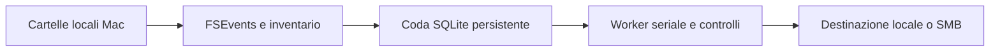

# MacSync

**Sincronizzazione unidirezionale nativa per macOS, verso cartelle locali o condivisioni SMB.**


[](https://github.com/Peppio1/MacSync-Public/actions/workflows/macos-ci.yml)

MacSync è un'applicazione desktop sviluppata in Swift e SwiftUI per replicare cartelle di lavoro del Mac su una destinazione locale o di rete, senza installare componenti sul server. La sorgente rimane l'unica fonte di verità: nessuna sincronizzazione inversa.

> **Stato: v0.16.0 candidata in validazione — aggiornamenti firmati con conferma e recupero assistito.** La pre-release v0.15.0 è l’ultima pubblicata. CI macOS: 177 test superati, 0 errori, 48 anteprime, installazione Sparkle 0.16.0 → 0.16.1 e rifiuto ZIP manomesso convalidati nel [run 44066873367](https://github.com/Peppio1/MacSync-Public/actions/runs/44066873367). Il collaudo integrato aggiornamento/riavvio/recupero e la firma del nuovo candidato sono in validazione. Collaudo fisico su iMac, SMB/VPN e Gatekeeper ancora necessario. Non utilizzare dati reali prima del collaudo.

## Download

### MacSync v0.15.0 — pre-release convalidata

[Scarica MacSync v0.15.0 (universale)](https://github.com/Peppio1/MacSync-Public/releases/download/v0.15.0/MacSync-v0.15.0-macOS-universal.zip) · [SHA-256](https://github.com/Peppio1/MacSync-Public/releases/download/v0.15.0/MacSync-v0.15.0-macOS-universal.zip.sha256) · [Release](https://github.com/Peppio1/MacSync-Public/releases/tag/v0.15.0). Non notarizzato, solo per collaudo.

### MacSync v0.16.0 — candidata non pubblicata

[Ultimo laboratorio di installazione superato](https://github.com/Peppio1/MacSync-Public/actions/runs/44066873367) · [Workflow correnti](https://github.com/Peppio1/MacSync-Public/actions). Gli artefatti CI richiedono accesso GitHub e scadono dopo 7 giorni. Nessuna release stabile: pacchetti ad hoc, non notarizzati, solo per test. Non usare le fixture del laboratorio come applicazioni reali.

## Funzionalità

- Configurazione grafica delle cartelle, tramite selezione Finder o drag and drop; più coppie separate e controllo delle sovrapposizioni.
- Sincronizzazione incrementale: monitor FSEvents, inventario locale e coda persistente SQLite; nessuna scansione ricorsiva della destinazione ad ogni ciclo ordinario.
- Avvio manuale immediato oppure pianificazione: 1–59 minuti, 1–23 ore, giornaliera o settimanale; avvio al login facoltativo e consenso separato per le copie automatiche.
- Copie prudenti con staging, controlli di identità e stabilità, protezione delle sostituzioni e ripresa dalla coda dopo interruzioni.
- Cancellazioni speculari facoltative, disattivate per impostazione predefinita, con consenso persistente esplicito; recupero opzionale e conservazione da 1 a 30 giorni o illimitata.
- Controllo della disponibilità delle destinazioni e notifiche facoltative per disconnessioni prolungate.
- Verifica archivio manuale o programmata: confronto rapido dei metadati oppure approfondito SHA-256; diagnostica non distruttiva e riallineamento facoltativo dei file mancanti/differenti.
- Riconoscimento dei file già copiati con verifica SHA-256 e conferma esplicita, utile per un archivio inizializzato in precedenza.
- Stato delle operazioni, avanzamento, tempi, velocità media di copia, storico per ciclo, dettagli per file e registro esportabile.
- Interfaccia in italiano, con temi chiaro e scuro e layout adattivo.
- Aggiornamenti solo stabili con controllo facoltativo ogni 24 ore, firma Ed25519 del feed e dello ZIP, conferma esplicita, backup preventivo e recupero assistito.

## Come funziona



MacSync usa la condivisione già montata e accessibile al Finder. Non gestisce VPN, password SMB o rimontaggi forzati; se la destinazione scompare, conserva le operazioni pendenti e ritenta quando è nuovamente accessibile e verificata. I permessi di lettura/scrittura degli altri utenti vengono configurati sul server, non da MacSync.

## Sicurezza e limiti

- Il mirror richiede autorizzazione esplicita per le coppie identificate; le eliminazioni anteriori al consenso non vengono riprodotte.
- Le protezioni tecniche sono obbligatorie. Le soglie facoltative contro eliminazioni massive e sorgente vuota sono disattivate per default.
- Spostamenti e rinomine sono trattati come nuova copia e rimozione del percorso precedente; le cancellazioni attendono il completamento degli upload pendenti.
- Il trasferimento interrotto riparte dall'inizio del singolo file; non è previsto resume a offset.
- Le normali copie verificano stabilità, identità e dimensione; non effettuano sempre un hash completo. La verifica approfondita legge i file anche dalla destinazione e può consumare banda VPN.
- I backup SQLite sono verificati e autonomi, includono i dati WAL confermati e vengono pubblicati senza sovrascritture. Non sostituiscono il backup delle fotografie o dei documenti.
- Non è garantita l'atomicità su tutte le implementazioni SMB; identità dei file dopo rimontaggio, ACL Windows, guasti reali e sospensione devono essere collaudati.

## Requisiti e compilazione

- macOS 13 o successivo secondo il manifest; CI su macOS 15. Compatibilità fisica con le altre versioni da verificare.
- Swift 5.9 o successivo per compilare, toolchain macOS con SDK.
- Destinazione locale oppure SMB già accessibile; nessun servizio MacSync richiesto sul server.

```bash
swift test
swift build -c release
```

La CI assembla anche un bundle MacSync.app con firma ad hoc, non notarizzato. I pacchetti temporanei e le anteprime grafiche si trovano negli [artefatti GitHub Actions](https://github.com/Peppio1/MacSync-Public/actions); possono scadere. Non sono release di produzione.

## Installazione e guida all'utilizzo

### 1. Installazione su macOS

Scaricare il pacchetto di prova, estrarre lo ZIP scaricato e, se presente un secondo archivio MacSync-prototype.zip, estrarre anche quello. Spostare MacSync.app nella cartella Applicazioni e avviarla. MacSync è un'applicazione della barra dei menu: da lì si apre la finestra di configurazione.

Essendo una build non notarizzata, macOS potrebbe impedirne l'apertura. Verificare provenienza e integrità del pacchetto prima di autorizzare eventualmente la singola applicazione nelle impostazioni Privacy e sicurezza. Non disattivare globalmente Gatekeeper. Usare soltanto file sintetici per il collaudo.

### 2. Configurazione delle cartelle

Aprire **Cartelle** e scegliere le sorgenti locali tramite **Sfoglia…** o trascinamento dal Finder. È possibile aggiungere sorgenti e configurare le rispettive destinazioni, anche sotto una cartella comune. Non selezionare percorsi sovrapposti.

Esempio dimostrativo:

```text
Mac (sorgente)                  Destinazione locale o SMB
Cartella_A             ─────►   Condivisione/Cartella_A
Cartella_B             ─────►   Condivisione/Cartella_B
```

Per una destinazione di rete, collegarsi prima alla condivisione SMB con Finder, quindi selezionare la cartella accessibile. Non occorre installare MacSync sul server.

### 3. Prima sincronizzazione

1. Attendere l'inventario delle sorgenti locali.
2. Aprire **Verifica archivio** ed eseguire un confronto diagnostico, senza riallineamento.
3. Se la destinazione contiene già una copia iniziale, usare la verifica approfondita e il riconoscimento dei file identici con conferma esplicita. Il confronto SHA-256 legge anche i dati remoti.
4. Nella **Panoramica**, scegliere **Avvia sincronizzazione**.
5. Controllare file copiati, coda residua, errori e risultati in **Registro attività**.

### 4. Pianificazione e avvio automatico

Dalla pagina **Pianificazione** scegliere l'intervallo in minuti oppure ore, o un orario giornaliero/settimanale. Per esempio, un ciclo ogni cinque minuti. Salvare l'impostazione.

In **Impostazioni** è possibile attivare separatamente l'avvio dell'app al login e la sincronizzazione automatica. L'avvio dell'app non autorizza da solo le copie o le eliminazioni. Se una destinazione non è accessibile, le scritture vengono sospese.

### 5. Cancellazioni speculari e recupero

| Impostazione | Comportamento |
|---|---|
| Cancellazione speculare disattivata (predefinita) | I file rimossi dalla sorgente rimangono nella destinazione |
| Mirror attivo, recupero attivo | Le eliminazioni autorizzate spostano i file nella cartella di recupero |
| Mirror attivo, recupero disattivato | Le eliminazioni autorizzate sono definitive |

L'attivazione del mirror richiede consenso esplicito. Provare questa funzione esclusivamente su archivi di test. Le eliminazioni precedenti all'autorizzazione non sono riprodotte. Le nuove copie hanno priorità sulle rimozioni: durante uno spostamento il vecchio percorso resta preservato finché le copie pendenti non sono completate.

### 6. Controllo delle operazioni e manutenzione

- **Panoramica:** stato, coda, avanzamento e riepilogo dei cicli.
- **Cartelle:** configurazione e associazione dei percorsi.
- **Pianificazione:** frequenza e prossimi cicli.
- **Verifica archivio:** confronto rapido o SHA-256, programmazione e manutenzione controllata.
- **Registro attività:** esiti, errori, dettagli e esportazione TSV.
- **Impostazioni:** avvio, aspetto, recupero, sicurezza e notifiche.

Usare **Ferma tutto** prima di interventi straordinari. Attendere la conclusione delle operazioni in corso; una chiamata SMB bloccata può ritardare la chiusura.

### 7. Aggiornamenti e recupero

In **Impostazioni → Aggiornamenti software**, usa Controlla o attiva il controllo automatico (non avvia download automatici). Installa MacSync.app in Applicazioni. La conferma iniziale sospende e drena le operazioni, crea uno snapshot verificato e apre Sparkle; conferma l’installazione nella sua finestra. Dopo annullamento o aggiornamento, riapri MacSync dalla posizione originale e verifica le impostazioni. Copie automatiche, mirror e audit pianificato restano disabilitati finché non li riabiliti esplicitamente.

Se MacSync non si avvia e l’installatore è terminato, apri nel Finder la cartella `~/Library/Application Support/MacSync/update-backups`, individua il backup della transazione pendente e apri **Ripristina MacSync.command**. Conferma con RIPRISTINA. Il recupero è offline, senza sudo; rifiuta database modificati o destinazioni/identità non verificabili, preserva l’app sostituita e non sovrascrive SQLite né preferenze. Non avviare il recupero mentre Sparkle sta ancora installando. La guida tecnica è in [Aggiornamenti e recupero](docs/UPDATES.md). Non eliminare manualmente il marcatore o i file di lock.

## Stato della validazione

Baseline pubblicata v0.15.0: [workflow 44047883363](https://github.com/Peppio1/MacSync-Public/actions/runs/44047883363). Ultima validazione completata v0.16.0: [56555ce](https://github.com/Peppio1/MacSync-Public/commit/56555ce8670b720e7ecec3841412791c448e1fe3), [workflow 44066873367](https://github.com/Peppio1/MacSync-Public/actions/runs/44066873367).

| Verifica | Risultato |
|---|---|
| Suite ordinaria | 177 superati, 0 falliti, 1 rendering opt-in separato (178 rilevati nell’ultimo run concluso) |
| Test integrato: due coppie, disconnessione simulata, backup e ripresa | Superato |
| Carico sintetico: 40 cartelle, 360 file, quattro cicli di modifica | Superato |
| Mirror definitivo e con recupero | Superato |
| Release build e 48 anteprime UI | Completati |
| 96 cicli accelerati, inventario 10.000 file, interruzione simulata | Superati |
| Compilazione universale v0.15.0 e v0.16.0 | Superata |
| Firma Ed25519 di produzione (candidato precedente) | Superata nel run 44063365937 |
| Installazione Sparkle e rifiuto archivio alterato | Superati nel run 44066873367 |
| Recupero e preflight su processi separati, firma ultima build | In validazione |
| Durata reale e risorse app installata | Da collaudare |
| Interazioni UI, avvio al login, arresto e SMB/VPN reale | Da collaudare |

Il successivo obiettivo è completare la candidata v0.16.0, poi v0.17.0 (icone, DMG, guida) e collaudo reale. Nessuna versione 1.0 stabile è dichiarata.

## Cronologia e changelog

Le versioni sono riportate dalla più recente alla più vecchia. Lo storico descrive lo sviluppo progressivo: le impostazioni e i limiti delle vecchie versioni non sostituiscono quelli della versione attuale.

### v0.16.0 — sistema aggiornamenti (candidata)

- Pannello aggiornamenti nelle Impostazioni e comando dalla barra menu.
- Controllo manuale e automatico delle release stabili; nessuna installazione non autenticata.
- Sparkle 2.10.0 integrato; feed e archivio firmati, conferma, arresto dei worker, backup e recupero assistito del solo bundle.
- Firma di produzione e installazione isolata già provate; collaudo integrato del riavvio e firma dell’ultima build in validazione. Nessuna release v0.16.0 pubblicata.

### v0.15.0 — consolidamento

- Motore, interfaccia, database e autorizzazioni invariati; versione visualizzata e metadati aggiornati.
- Compilazione universale arm64/x86_64, controllo firma ad hoc, verifica del pacchetto estratto e checksum SHA-256.
- Workflow di pubblicazione condizionato alla regressione completa, senza sovrascrivere release esistenti.
- Baseline precedente: 167 test ordinari superati, 96 cicli accelerati, inventario di 10.000 file.
- Nessuna dichiarazione di stabilità in produzione; collaudo reale ancora necessario.

### v0.14.3 — baseline precedente

- Backup SQLite autonomi tramite VACUUM INTO, correzione della creazione del file temporaneo su macOS, controllo integrità e pubblicazione esclusiva.
- Validazione della ripresa dopo disconnessione simulata, ripristino separato della coda e diagnostica finale.
- Test di carico con 40 cartelle e 360 file sintetici, quattro cicli di aggiornamento e verifica delle cancellazioni definitive/con recupero.
- 164 test ordinari superati, nessun errore; rendering separato e 48 anteprime.
- Validazione prolungata e collaudo fisico ancora da effettuare.

### v0.14.0 – v0.14.2 — sicurezza operativa

| Versione | Novità |
|---|---|
| v0.14.2 | Isolamento dei backup SQLite e pubblicazione esclusiva degli snapshot verificati |
| v0.14.1 | Correzioni dei test di riconnessione, nomi Unicode e gestione WAL |
| v0.14.0 | Identità persistente delle cartelle, controlli Windows, blocco istanze multiple, sicurezza database, arresto controllato e gestione delle pubblicazioni interrotte |

### v0.13 — interfaccia grafica e organizzazione

| Versione | Novità |
|---|---|
| v0.13.9 | Ripristino del pannello operativo della verifica archivio |
| v0.13.8 | Layout desktop adattivo e 48 anteprime nei due temi |
| v0.13.7 | Miglioramento del layout della verifica e dei nomi dei giorni |
| v0.13.6 | Organizzazione della schermata verifica archivio |
| v0.13.5 | Verifica archivio unificata e riconoscimento SHA-256 |
| v0.13.4 | Configurazione delle sorgenti e destinazione comune, modifica protetta della pianificazione |
| v0.13.3 | Layout desktop compatto |
| v0.13.2 | Revisione UI/UX e annullamento del singolo ciclo |
| v0.13.1 | Consolidamento della compilazione e delle anteprime automatiche |
| v0.13.0 | Nuova organizzazione dell'interfaccia e della pianificazione |

### Versioni precedenti — sviluppo del motore

| Versione | Novità |
|---|---|
| v0.12.4 | Statistiche dettagliate, avanzamento, storico e verifica completa programmabile |
| v0.12.3 | Autorizzazione persistente del mirror e protezioni facoltative configurabili |
| v0.12.2 | Ripartenza dei file interrotti e gestione dei temporanei |
| v0.12.1 | Gestione prudente dei backup temporanei |
| v0.12 | Coda paginata e prestazioni dei cicli |
| v0.11 | Resilienza, verifica dei file e sicurezza delle sostituzioni |
| v0.10.1 | Correzioni della pianificazione e degli avvisi |
| v0.10 | Intervalli configurabili e avviso di disconnessione |
| v0.9.1 | Ripresa automatica delle copie |
| v0.9 | Avvio al login e verifica della disponibilità |
| v0.8.1 | Correzione dello scanner e riepilogo operativo |
| v0.8 | Cancellazioni speculari, recupero e conservazione |
| v0.7 | Riconoscimento SHA-256 dei file già presenti |
| v0.6 | Spazio disponibile, staging, diagnostica e registro |
| v0.5 | Base del prototipo: monitoraggio locale, coda SQLite e replica unidirezionale |

Per le modifiche tecniche dettagliate di ogni versione consultare lo [storico completo dello sviluppo](docs/DEVELOPMENT_HISTORY.md) e lo [storico dell'architettura](docs/ARCHITECTURE_HISTORY.md).

### Prossime fasi

- Consolidare i risultati dei test di durata accelerata e verificare il pacchetto universale.
- Preparare la candidata al rilascio e la procedura di collaudo.
- Verificare macOS, Windows SMB, VPN, permessi e ripresa dopo interruzioni reali.
- Pubblicare una versione stabile soltanto dopo la validazione.

## Documentazione

- [Architettura tecnica](docs/ARCHITECTURE.md)
- [Contesto di sviluppo e regole di sicurezza](AGENTS.md)
- [Note storiche di sviluppo](docs/DEVELOPMENT_HISTORY.md)
- [Architettura storica](docs/ARCHITECTURE_HISTORY.md)

L'edizione pubblica contiene solo esempi e dati sintetici. Non pubblicare configurazioni aziendali, fotografie, database operativi, credenziali o log sensibili. Il repository attualmente non contiene una licenza esplicita: la disponibilità del codice non costituisce di per sé autorizzazione al riutilizzo o alla redistribuzione.
