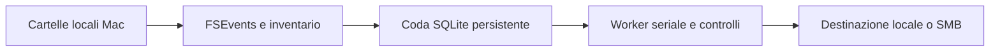

# MacSync

**Sincronizzazione unidirezionale nativa per macOS, verso cartelle locali o condivisioni SMB.**


[](https://github.com/Peppio1/MacSync-Public/actions/workflows/macos-ci.yml)

MacSync è un'applicazione desktop sviluppata in Swift e SwiftUI per replicare cartelle di lavoro del Mac su una destinazione locale o di rete, senza installare componenti sul server. La sorgente rimane l'unica fonte di verità: nessuna sincronizzazione inversa.

> **Stato: v0.14.3 — prototipo in validazione avanzata.** I test su cartelle locali macOS sono superati. Il collaudo su iMac, SMB/VPN reale e applicazione installata è ancora necessario. Non utilizzare con dati di produzione prima del collaudo.

## Funzionalità

- Configurazione grafica delle cartelle, tramite selezione Finder o drag and drop; più coppie separate e controllo delle sovrapposizioni.
- Sincronizzazione incrementale: monitor FSEvents, inventario locale e coda persistente SQLite; nessuna scansione ricorsiva della destinazione ad ogni ciclo ordinario.
- Avvio manuale immediato oppure pianificazione: 1–59 minuti, 1–23 ore, giornaliera o settimanale; avvio al login facoltativo e consenso separato per le copie automatiche.
- Copie prudenti con staging, controlli di identità e stabilità, protezione delle sostituzioni e ripresa dalla coda dopo interruzioni.
- Cancellazioni speculari facoltative, disattivate per impostazione predefinita, con consenso persistente esplicito; recupero opzionale e conservazione da 1 a 30 giorni o illimitata.
- Controllo della disponibilità delle destinazioni e notifiche facoltative per disconnessioni prolungate.
- Verifica archivio manuale o programmata: confronto rapido dei metadati oppure approfondito SHA-256; diagnostica non distruttiva e riallineamento facoltativo dei file mancanti/differenti.
- Riconoscimento dei file già copiati con verifica SHA-256 e conferma esplicita, utile per un archivio inizializzato in precedenza.
- Stato delle operazioni, avanzamento, tempi, velocità media di copia, storico per ciclo, dettagli per file e registro esportabile.
- Interfaccia in italiano, con temi chiaro e scuro e layout adattivo.

## Come funziona



MacSync usa la condivisione già montata e accessibile al Finder. Non gestisce VPN, password SMB o rimontaggi forzati; se la destinazione scompare, conserva le operazioni pendenti e ritenta quando è nuovamente accessibile e verificata. I permessi di lettura/scrittura degli altri utenti vengono configurati sul server, non da MacSync.

## Sicurezza e limiti

- Il mirror richiede autorizzazione esplicita per le coppie identificate; le eliminazioni anteriori al consenso non vengono riprodotte.
- Le protezioni tecniche sono obbligatorie. Le soglie facoltative contro eliminazioni massive e sorgente vuota sono disattivate per default.
- Spostamenti e rinomine sono trattati come nuova copia e rimozione del percorso precedente; le cancellazioni attendono il completamento degli upload pendenti.
- Il trasferimento interrotto riparte dall'inizio del singolo file; non è previsto resume a offset.
- Le normali copie verificano stabilità, identità e dimensione; non effettuano sempre un hash completo. La verifica approfondita legge i file anche dalla destinazione e può consumare banda VPN.
- I backup SQLite sono verificati e autonomi, includono i dati WAL confermati e vengono pubblicati senza sovrascritture. Non sostituiscono il backup delle fotografie o dei documenti.
- Non è garantita l'atomicità su tutte le implementazioni SMB; identità dei file dopo rimontaggio, ACL Windows, guasti reali e sospensione devono essere collaudati.

## Requisiti e compilazione

- macOS 13 o successivo secondo il manifest; CI su macOS 15. Compatibilità fisica con le altre versioni da verificare.
- Swift 5.9 o successivo per compilare, toolchain macOS con SDK.
- Destinazione locale oppure SMB già accessibile; nessun servizio MacSync richiesto sul server.

```bash
swift test
swift build -c release
```

La CI assembla anche un bundle MacSync.app con firma ad hoc, non notarizzato. I pacchetti temporanei e le anteprime grafiche si trovano negli [artefatti GitHub Actions](https://github.com/Peppio1/MacSync-Public/actions); possono scadere. Non sono release di produzione.

## Primo collaudo

1. Creare cartelle locali di prova separate, con file sintetici e nessun dato originale.
2. Configurare sorgenti e destinazioni senza sovrapposizioni.
3. Eseguire una verifica diagnostica prima di attivare le copie.
4. Effettuare una sincronizzazione manuale; controllare contenuto dei file e registro.
5. Provare modifiche, disconnessione, riavvio e cancellazioni con recupero prima di valutare l'automazione.
6. Ripetere su una condivisione SMB dedicata ai test, verificando permessi e continuità della rete.

## Stato della validazione

Ultima baseline convalidata: [610ecbd](https://github.com/Peppio1/MacSync-Public/commit/610ecbd37b2e62bb885ee769ce514be9e1b36a37), [workflow 43983414603](https://github.com/Peppio1/MacSync-Public/actions/runs/43983414603).

| Verifica | Risultato |
|---|---|
| Suite ordinaria | 164 superati, 0 falliti, 1 rendering opt-in separato (165 schedulati) |
| Test integrato: due coppie, disconnessione simulata, backup e ripresa | Superato |
| Carico sintetico: 40 cartelle, 360 file, quattro cicli di modifica | Superato |
| Mirror definitivo e con recupero | Superato |
| Release build e 48 anteprime UI | Completati |
| Durata, risorse, scalabilità estesa | Da completare |
| Interazioni UI, avvio al login, arresto e SMB/VPN reale | Da collaudare |

Il successivo obiettivo è completare la validazione avanzata, consolidare una candidata al rilascio e procedere al collaudo fisico. Nessuna versione 1.0 stabile è dichiarata.

## Documentazione

- [Architettura tecnica](docs/ARCHITECTURE.md)
- [Contesto di sviluppo e regole di sicurezza](AGENTS.md)
- [Note storiche di sviluppo](docs/DEVELOPMENT_HISTORY.md)
- [Architettura storica](docs/ARCHITECTURE_HISTORY.md)

L'edizione pubblica contiene solo esempi e dati sintetici. Non pubblicare configurazioni aziendali, fotografie, database operativi, credenziali o log sensibili. Il repository attualmente non contiene una licenza esplicita: la disponibilità del codice non costituisce di per sé autorizzazione al riutilizzo o alla redistribuzione.
